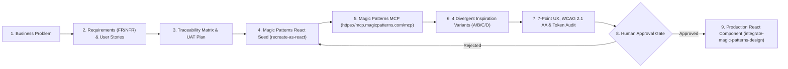

# 🎨 Enterprise AI Product Design Studio

[](https://github.com/phlppgdfry/enterprise-ai-product-design-studio/actions/workflows/validate.yml)

**Van bedrijfsprobleem naar requirements, Magic Patterns-prototypes, geautomatiseerde UX/WCAG-validatie en productierijpe React-componenten.**

Dit project combineert de drie kernprojecten uit de Magic Patterns-strategie in één werkende, testbare enterprise-architectuur:

1. **🥇 Enterprise AI Product Design Studio** (`enterprise-ai-product-design-studio`) — Volledige keten van *Business Problem → Requirements → Magic Patterns Seed & 4 Varianten → 7-punts UX/WCAG Audit → Human Approval Gate → Production React*.
2. **🥈 AI UX Audit & Redesign Agent** — Automatische **Before vs. After** UX- en toegankelijkheidsanalyse (inclusief wiskundige WCAG 2.1 contrastberekening, ontbrekende fout-/laad-/leeg-staten en design-system token-checks).
3. **🥉 Requirements-to-Prototype Engine** — Genereert functionele/niet-functionele requirements (`FR`/`NFR`), User Stories met Gherkin-acceptatiecriteria (`Given/When/Then`), een Mermaid-procesdiagram, een volledige **Traceability Matrix** en een **UAT-testplan**.

[**🌐 Open Live Studio Workbench**](https://enterprise-ai-product-design-studio.vercel.app) · [**🏆 Badges, Certificeringen & 1-Klik LinkedIn Links**](BADGES_AND_CERTIFICATIONS.md) · [30-Dagenplan & 100-Punten Rubric](docs/PLAYBOOK_30_DAYS_AND_RUBRIC.md) · [Geverifieerde Uitvoeringsbon](docs/VERIFICATION_RECEIPT.json)

---

## Architectuur & Tweerichtingsworkflow



---

## Snel starten (Lokaal & Zonder Externe Kosten)

Vereist Node.js 22+. Alle lokale analyses, zaadbestanden (*seeds*), 4 ontwerpvarianten en 7-punts UX/WCAG-audits draaien volledig deterministisch zonder betaalde API-calls.

```bash
cd ~/enterprise-ai-product-design-studio
npm run generate:seeds
npm test
npm run verify
npm start
```

Open **http://127.0.0.1:4180** voor de interactieve **Studio Workbench**.

### Beschikbare CLI (`magic-patterns`)

Omdat Magic Patterns geen zelfstandige officiële CLI meelevert, bevat dit project een lokale CLI (gekoppeld op `~/.local/bin/magic-patterns` en via `agent-tools`):

```bash
magic-patterns status                                       # Controleer MCP-status in alle 7 agents + 6 officiële skills
magic-patterns cases                                        # Toon de 3 ingebouwde enterprise-cases
magic-patterns audit skillsbridge-review-console            # Voer de 7-punts UX & WCAG 2.1 AA contrast-audit uit
magic-patterns generate quay-container-exceptions           # Genereer Magic Patterns React-seed + baseline.html + MCP-payload
magic-patterns approve skillsbridge-review-console \
  --reviewer "Philippe Godfroy" \
  --rationale "Verified 100% FR/NFR coverage and WCAG AA contrast" \
  --variant A
```

---

## Ingebouwde Enterprise Cases (Direct Koppelbaar aan Bestaande Portfolio-Projecten)

| Case ID | Project / Domein | Wat wordt bewezen | Gegenereerde Seed Map | Live Magic Patterns Editor |
|---|---|---|---|---|
| `skillsbridge-review-console` | **SkillsBridge Enterprise Product Case** (*HR Tech & AI Governance*) | Menselijke review van IT-incidentbewijs tegen ESCO-vaardigheden, idempotente synchronisatie en HTTP 503 outage recovery. | [`seeds/skillsbridge-review-console/`](seeds/skillsbridge-review-console) | [**Open Editor (jhvkpwft...)**](https://www.magicpatterns.com/c/jhvkpwft3f3urpoatsfztf) |
| `quay-container-exceptions` | **QuayReady Container Exception Engine** (*Port Logistics & Warehouse BA/FA*) | Inkomende containers registreren, ETA-vertragingen opvolgen, zegel-/douane-afwijkingen melden en gate-holds plaatsen. | [`seeds/quay-container-exceptions/`](seeds/quay-container-exceptions) | [**Open Editor (h7r6nj96...)**](https://www.magicpatterns.com/c/h7r6nj96m2lttknrvcayjy) |
| `ai-ux-audit-dashboard` | **Auditly AI UX Audit & Redesign Hub** (*AI Product Management & UX Governance*) | Bestaande schermen analyseren op contrast, states en design tokens, en 4 Magic Patterns-varianten vergelijken. | [`seeds/ai-ux-audit-dashboard/`](seeds/ai-ux-audit-dashboard) | [**Open Editor (xrowqyby...)**](https://www.magicpatterns.com/c/xrowqybya7cmog5nxpundx) |

> [!NOTE]
> **Live MCP-Uploads & Credit-Verbruik:** Alle drie de cases zijn rechtstreeks via de officiële Magic Patterns MCP Server (`https://mcp.magicpatterns.com/mcp`) geüpload, gecompileerd via `publish_artifact`, en AI-geëvolueerd met accountcredits via `send_prompt` op account `philgodf@gmail.com`. De live standaarden zijn ook direct te openen via de knoppen in de [Live Studio Workbench](https://enterprise-ai-product-design-studio.vercel.app).

---

## De 7 Gecontroleerde UX- & Engineeringdimensies

Elke case en elk gegenereerd prototype wordt automatisch getoetst op zeven controleerbare criteria:

1. **Requirement Coverage (`DIM-01`)** — Zijn alle `FR-*` en `NFR-*` requirements gekoppeld aan een concreet UI-component en UAT-testgeval in de Traceability Matrix?
2. **Navigatie & Informatiearchitectuur (`DIM-02`)** — Duidelijke hiërarchie en vergelijking over 4 structurele richtingen (*A: Split Operations Canvas*, *B: Progressive Triage Feed*, *C: High-Density Matrix*, *D: Guided 4-Step Wizard*).
3. **Gebruikersscenario's (`DIM-03`)** — Volledige Gherkin-acceptatiecriteria (`Given / When / Then`) voor happy path, filtering en foutafhandeling.
4. **Expliciete UI-Toestanden (`DIM-04`)** — Naast de interactieve staat zijn ook `empty`, `loading` en `error` (`HTTP 503 Service Unavailable` met idempotente retry) ontworpen en schakelbaar.
5. **WCAG 2.1 AA Toegankelijkheid (`DIM-05`)** — Wiskundige relatieve-luminantie contrastcontrole (`>= 4.5:1` voor alle tekst/achtergrond-combinaties, tegenover `< 2.4:1` in de legacy baseline), plus `role="banner"`, `role="main"`, `role="alert"`, `aria-live` en `htmlFor`-labels.
6. **Design System Compliance (`DIM-06`)** — Alle kleuren, radii (`10px` cards, `6px` controls) en typografie (`Inter` + `JetBrains Mono`) volgen het **Northstar Enterprise Design System**.
7. **Prototype-to-Code Parity (`DIM-07`)** — Conform de officiële Magic Patterns skills (`recreate-as-react` & `integrate-magic-patterns-design`): uitsluitend *named exports*, exacte Tailwind `@import`-volgorde in `index.css`, geen TypeScript `any`, en bij productie-export worden alle Vite/prototype-scaffoldingbestanden verwijderd.

---

## Gedeelde Agent- & MCP-Setup op deze Mac

De officiële Magic Patterns MCP-server (`https://mcp.magicpatterns.com/mcp`) en de 6 officiële skills uit [`magicpatterns/agent-plugins`](https://github.com/magicpatterns/agent-plugins) zijn centraal geconfigureerd en gesynchroniseerd:

- **MCP-server actief in:** Claude Code (`~/.claude.json`), OpenAI Codex (`~/.codex/config.toml` — OAuth aangemeld), Cursor (`~/.cursor/mcp.json` + lokale plugin in `~/.cursor/plugins/local/magic-patterns`), VS Code, GitHub Copilot CLI, Antigravity en Gemini CLI.
- **Officiële Agent Skills geïnstalleerd in `~/.agents/skills/`:**
  - `prototype` — Lokaal scherm seeden en via `send_prompt` creatief uitwerken in Magic Patterns.
  - `inspiration` — 4 parallelle ontwerpvarianten genereren en streamen naar een deelbare Magic Patterns-vergelijkingspagina.
  - `upload-to-magic-patterns` — Lokale React-componenten deterministisch uploaden naar de Magic Patterns-editor.
  - `integrate-magic-patterns-design` — Goedgekeurd Magic Patterns-prototype vertalen naar productiecode binnen het bestaande designsysteem.
  - `recreate-as-react` — Bestaande UI vertalen naar een zelfstandige React + TypeScript + Tailwind v3 seed-set.
  - `recreate-as-raw-html` — Bestaande UI vertalen naar één zelfstandig HTML-bestand voor baseline-vergelijking.

---

## Eerlijke Verantwoording & Grenzen

- De lokale workbench, UX/WCAG-evaluator en seed-generator werken 100% deterministisch en offline; ze verbruiken geen Magic Patterns-credits.
- Live generaties op `magicpatterns.com` (via de MCP-tools `create_design`, `send_prompt` en `create_inspiration_document`) vereisen een aangemeld Magic Patterns-account en verbruiken platformcredits afhankelijk van je abonnement.
- De 100-punten competentiescore in [`docs/PLAYBOOK_30_DAYS_AND_RUBRIC.md`](docs/PLAYBOOK_30_DAYS_AND_RUBRIC.md) is een transparante zelfbeoordelingsrubric op basis van aantoonbare repository-artefacten, geen officieel Magic Patterns-examencertificaat.
